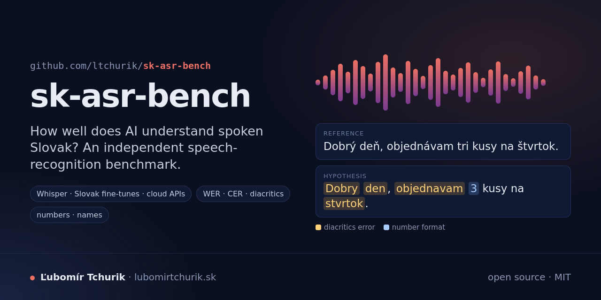

# sk-asr-bench

[](https://github.com/ltchurik/sk-asr-bench)

**How well does AI understand spoken Slovak?** A reproducible, independent benchmark of Slovak speech recognition: open models (Whisper and its Slovak fine-tunes, NVIDIA Parakeet/Canary, …) and commercial APIs scored on the same test sets with the same normalization.

[](https://github.com/ltchurik/sk-asr-bench/actions/workflows/ci.yml)
[](LICENSE)

[](https://doi.org/10.5281/zenodo.24252739)

> **Status (2026-11-17):** 17 open systems and 7 commercial APIs on FLEURS and Common Voice 27.0. A held-out test set is next.

🇸🇰 [Po slovensky](#po-slovensky) · [Results](#results) · [Why](#why) · [Methodology](#methodology) · [Quickstart](#quickstart) · [Roadmap](#roadmap) · [Citing](#citing)

Part of a series on Slovak in AI: [sk-llm-eval](https://github.com/ltchurik/sk-llm-eval) (does the model *write* correct Slovak?) and [sk-tokenizer-bench](https://github.com/ltchurik/sk-tokenizer-bench) (how much more does Slovak cost in tokens?).

## Results

17 open systems, greedy decoding, fp16, one NVIDIA DGX Spark (GB10). FLEURS `sk_sk` test (792 utterances) and Common Voice 27.0 Slovak test (6,006 utterances). WER, CER and diacritics error rate in %; sorted by FLEURS WER.

| System | Training data (per model card) | FLEURS WER | FLEURS CER | FLEURS diacritics | CV WER | CV CER | CV WER ≤3 words | CV WER >3 words | RTF |
|---|---|---:|---:|---:|---:|---:|---:|---:|---:|
| [kinit/whisper-large-v3-sk](https://huggingface.co/kinit/whisper-large-v3-sk) | SloPalSpeech, CV 24 ⚠, FLEURS ⚠, internal | **4.88** | **1.82** | 0.32 | 7.27 | 2.23 | 13.10 | 5.80 | 0.033 |
| [kinit/whisper-large-v3-turbo-sk](https://huggingface.co/kinit/whisper-large-v3-turbo-sk) | SloPalSpeech, CV 24 ⚠, FLEURS ⚠, internal | 5.46 | 1.92 | **0.30** | 8.86 | 2.63 | 16.44 | 6.96 | 0.012 |
| [NaiveNeuron/whisper-large-v3-sk](https://huggingface.co/NaiveNeuron/whisper-large-v3-sk) | SloPalSpeech | 5.56 | 2.11 | 0.40 | 10.53 | 3.47 | 20.47 | 8.04 | 0.125¹ |
| [kinit/whisper-medium-sk](https://huggingface.co/kinit/whisper-medium-sk) | SloPalSpeech, CV 24 ⚠, FLEURS ⚠, internal | 5.98 | 2.17 | 0.44 | 9.99 | 3.11 | 17.95 | 8.00 | 0.020 |
| [NaiveNeuron/whisper-large-v3-turbo-sk](https://huggingface.co/NaiveNeuron/whisper-large-v3-turbo-sk) | SloPalSpeech | 6.46 | 2.32 | 0.54 | 12.07 | 3.63 | 23.07 | 9.32 | 0.007 |
| [NaiveNeuron/whisper-medium-sk](https://huggingface.co/NaiveNeuron/whisper-medium-sk) | SloPalSpeech | 7.83 | 3.05 | 0.46 | 16.16 | 6.64 | 34.78 | 11.49 | 0.050¹ |
| [openai/whisper-large-v3](https://huggingface.co/openai/whisper-large-v3) | undisclosed web data | 9.35 | 2.79 | 1.93 | 19.09 | 5.58 | 37.18 | 14.56 | 0.034 |
| [kinit/whisper-small-sk](https://huggingface.co/kinit/whisper-small-sk) | SloPalSpeech, CV 24 ⚠, FLEURS ⚠, internal | 9.72 | 3.95 | 0.64 | 13.35 | 4.17 | 23.66 | 10.77 | 0.010 |
| [openai/whisper-large-v3-turbo](https://huggingface.co/openai/whisper-large-v3-turbo) | undisclosed web data | 10.19 | 2.92 | 2.06 | 28.45 | 9.22 | 61.96 | 20.05 | 0.013 |
| [nvidia/parakeet-tdt-0.6b-v3](https://huggingface.co/nvidia/parakeet-tdt-0.6b-v3) | Granary, CV 7.0 ⚠, FLEURS ⚠, … | 10.23 | 3.17 | 1.21 | 8.30 | 2.24 | 12.27 | 7.31 | 0.027 |
| [BuzzASR/slovak](https://huggingface.co/BuzzASR/slovak) | FLEURS ⚠, CV 25 ⚠ | 10.70 | 5.05 | 0.65 | *1.19*² | *0.40*² | *1.91*² | *1.01*² | 0.021 |
| [NaiveNeuron/whisper-small-sk](https://huggingface.co/NaiveNeuron/whisper-small-sk) | SloPalSpeech | 10.85 | 3.51 | 0.72 | 23.51 | 8.90 | 43.18 | 18.58 | 0.005¹ |
| [openai/whisper-medium](https://huggingface.co/openai/whisper-medium) | undisclosed web data | 18.87 | 4.95 | 3.32 | 35.88 | 10.65 | 60.43 | 29.73 | 0.021 |
| [mikr/whisper-medium-sk-cv11](https://huggingface.co/mikr/whisper-medium-sk-cv11) | CV 11 ⚠ | 20.39 | 6.91 | 2.50 | 18.65 | 4.55 | 19.64 | 18.40 | 0.013 |
| [infinitejoy/wav2vec2-large-xls-r-300m-slovak](https://huggingface.co/infinitejoy/wav2vec2-large-xls-r-300m-slovak) | CV 7.0 ⚠ | 27.36 | 8.09 | 2.71 | 25.95 | 5.75 | 26.71 | 25.76 | 0.002 |
| [mikr/whisper-small-sk-cv11](https://huggingface.co/mikr/whisper-small-sk-cv11) | CV 11 ⚠ | 31.12 | 9.23 | 3.36 | 37.85 | 13.08 | 51.99 | 34.30 | 0.006 |
| [openai/whisper-small](https://huggingface.co/openai/whisper-small) | undisclosed web data | 38.18 | 10.02 | 5.27 | 57.06 | 16.44 | 89.73 | 48.87 | 0.010 |

⚠ **In-domain:** the model was trained on the training split of that corpus, so its score on the matching test set is not comparable with models that never saw the corpus. FLEURS splits do not share sentences, but recording conditions and reading style are the same. Common Voice draws new splits with every release, so clips in the 27.0 test split may have been in the training split of the earlier release a model used.

¹ These models ship with `use_cache=False` in their generation config; the RTF was measured that way. With the KV cache (now forced by the harness, transcripts identical) they run about 3× faster, as the turbo row shows. RTF is indicative only: runs shared the machine.

² Almost certainly test-set overlap: BuzzASR was trained on Common Voice 25, its FLEURS score is in line with stock Whisper large-v3, and 1.19 % WER is far below every other system. Do not use this number to rank it.

**What the numbers say**

- **Best on FLEURS:** kinit/whisper-large-v3-sk (4.88 % WER), but it was trained on FLEURS and Common Voice. **Best system that saw neither test corpus:** NaiveNeuron/whisper-large-v3-sk (5.56 % FLEURS, 10.53 % CV), trained only on parliamentary speech.
- **Slovak fine-tuning fixes diacritics.** Stock Whisper large-v3 gets 1.9 % of words wrong only in diacritics; the kinit and NaiveNeuron fine-tunes stay at 0.3–0.7 %. The older mikr models (2022, Common Voice 11 only) do not.
- **Stock Whisper breaks on short clips.** Almost half of the Slovak Common Voice test split (2,907 clips) has three words or fewer, often single words or lists like *jazero; rybník; močiar*. Whisper large-v3-turbo has 62 % WER on those, against 20 % on longer sentences, with hallucinated loops and even Icelandic output. FLEURS, with full sentences only, hides this.
- **Greedy decoding** is used for every system; beam search of 5 would lower Whisper WER by roughly one point.

Reproduce a row with `sk-asr-bench run --system transformers:<model> --dataset fleurs --batch-size 32` (or `--dataset commonvoice:<dir>`), then `sk-asr-bench report`. Per-run summaries are in [`results/`](results/).

### Commercial APIs (via OpenRouter)

7 hosted speech-to-text models on the same test sets, called through [OpenRouter](https://openrouter.ai)'s `/audio/transcriptions` endpoint (2026-11-16) with `language=sk`, audio sent as 16 kHz WAV. Cost is what OpenRouter billed for these runs (`usage.cost`), per hour of audio. Training data of these models is not disclosed, so overlap with FLEURS or Common Voice cannot be ruled out.

| System | FLEURS WER | FLEURS CER | FLEURS diacritics | CV WER | CV CER | CV WER ≤3 words | CV WER >3 words | USD per audio hour |
|---|---:|---:|---:|---:|---:|---:|---:|---:|
| elevenlabs/scribe-v2 | **2.68** | **1.24** | **0.20** | **6.75** | 2.09 | 17.64 | **4.02** | 0.22 |
| nvidia/nemotron-3.5-transcribe | 6.92 | 3.60 | 0.63 | 18.29 | 5.97 | 43.20 | 12.04 | 0.10 |
| moondream/parakeet-ultra | 7.85 | 2.41 | 1.15 | 7.76 | **1.97** | **11.84** | 6.73 | 0.06 |
| x-ai/grok-stt-2.0 | 9.22 | 3.77 | 1.37 | 18.48 | 5.44 | 35.84 | 14.13 | 0.10 |
| meta/muse-voice-transcribe-1.0 | 11.04 | 4.47 | 1.14 | *30.37*³ | *11.19*³ | *50.87*³ | *25.21*³ | 0.18 |
| mistralai/voxtral-mini-3b-2507 | 25.10 | 9.27 | 3.79 | *144.61*³ | *75.54*³ | *51.69*³ | *165.30*³ | 0.06 |
| nvidia/nemotron-3.5-asr-streaming-multilingual-0.6b | 49.98 | 15.01 | 9.18 | 69.19 | 32.88 | 86.38 | 64.88 | 0.01 |

³ Incomplete run: the provider kept refusing the remaining clips (Meta: HTTP 429 on 5,376 of 6,006 done; Mistral: HTTP 504 timeouts on 3,474 done). Scores are over the clips that were transcribed and are indicative only.

- **ElevenLabs Scribe v2 is the most accurate system in the benchmark**, open or commercial: 2.68 % WER on FLEURS, half the error of the best open fine-tune, and near-perfect diacritics.
- **Parakeet-ultra is the best value** (about 6 cents per audio hour) and the only API that is as good on short Common Voice clips as on full sentences.
- Grok, Nemotron-transcribe and Meta Muse break on short clips the way stock Whisper does; Voxtral Mini hallucinates on them (WER over 100 %). Qwen3-ASR was excluded because it does not support Slovak (it answered in Czech).

Reproduce with `OPENROUTER_API_KEY=... sk-asr-bench run --system openrouter:<model> --dataset fleurs`. Set `SK_ASR_CONCURRENCY` (default 8) to the number of parallel requests; with a small credit balance use 1, because OpenRouter reserves credit for every request in flight.

## Why

If you want to transcribe Slovak meetings, calls, court hearings or podcasts today, you have to choose between a dozen ASR systems based on numbers that cannot be compared:

- **Different test sets.** FLEURS, Common Voice (several versions), parliament recordings, children's speech.
- **Different metrics.** Some report WER, some only CER; normalization (case, punctuation, numbers) is rarely stated.
- **Self-reported.** Most Slovak figures come from the authors of a fine-tune or from a vendor's marketing page.

Nobody runs all the systems on the same audio with the same scorer. This repository does, and publishes everything needed to reproduce it.

## What it measures

| Metric | What it tells you |
|---|---|
| **WER** | Word error rate after normalization (case, punctuation, whitespace). Pooled over the corpus, not averaged per utterance. |
| **CER** | Character error rate; fairer for a highly inflected language where one wrong suffix makes the whole word wrong. |
| **Diacritics error rate** | Share of words that are wrong *only* in diacritics (`ucitel` vs `učiteľ`). Diacritics are never stripped by the normalizer, because a Slovak reader sees them as errors. |
| **Numbers, dates, names** | Accuracy on tagged spans in the reference (`{num:1 250}`, `{date:12. marca}`, `{name:Jána Nováka}`): the parts of a transcript that matter most in practice and that WER hides. |
| **Speed** | Transcription time per run (real-time factor on the reference hardware: NVIDIA DGX Spark, GB10). |

## Methodology

- **Normalization** (`sk_asr_bench.normalize`): Unicode NFC, lowercase, punctuation and symbols removed except inside numbers (`3,5`, `10:30`), thousands separators joined (`1 250` → `1250`), whitespace collapsed. Optional hook for number verbalization. Diacritics are kept.
- **Alignment**: plain Levenshtein with backtrace, implemented in ~100 lines with no dependencies, so the scorer is auditable and identical everywhere.
- **Test sets** (audio is never stored in this repo; loaders fetch it):
  - [FLEURS](https://huggingface.co/datasets/google/fleurs) `sk_sk` test split (CC-BY 4.0)
  - [Common Voice](https://commonvoice.mozilla.org) Slovak test split (CC0), version 27.0; download it yourself from [Mozilla Data Collective](https://mozilladatacollective.com) after accepting its terms
  - a **new held-out set** written and recorded for this benchmark (numbers, dates, names, regional accents, telephone-quality audio), so that no model can have trained on it. *Planned.*
  - SloPalSpeech (parliamentary speech, CC BY 4.0) is a training corpus with no held-out split, and several systems under test were fine-tuned on it, so it is not used as a test set.
- **Systems**: run with `language=sk`, fp16 on the GPU and **greedy decoding** for every system (Whisper included, so it is compared on equal terms with the CTC/TDT models; beam search of 5 lowers Whisper large-v3 WER on FLEURS by about one point but is several times slower). Every run stores per-utterance transcripts so that each number can be inspected.
- **Training-data overlap** is flagged in the results: a fine-tune trained on the same corpus as a test set (e.g. on the FLEURS or Common Voice training split) is scored but marked as in-domain.

## Prior art

- **SloPalSpeech** ([arXiv 2509.19270](https://arxiv.org/abs/2509.19270)): a 2,806-hour Slovak parliamentary corpus with Whisper fine-tunes and baselines on FLEURS and Common Voice. An excellent training resource; it evaluates its own models, not a broad set of systems.
- **Model cards** such as [NaiveNeuron/whisper-large-v3-sk](https://huggingface.co/NaiveNeuron/whisper-large-v3-sk) and [BuzzASR/slovak](https://huggingface.co/BuzzASR/slovak) report their own WER/CER on their chosen splits.
- **Vendors** (e.g. ElevenLabs) publish Slovak WER claims without a reproducible method.

sk-asr-bench does not compete with these; it puts them side by side under one scorer.

## Quickstart

What works today: scoring any system's output and running local or OpenAI-compatible models.

```bash
git clone https://github.com/ltchurik/sk-asr-bench
cd sk-asr-bench
pip install -e ".[dev]"
pytest

# score precomputed transcripts (any system, any source)
sk-asr-bench run --system hyp:tests/fixtures/hyp.jsonl --dataset jsonl:tests/fixtures/refs.jsonl

# local Whisper on FLEURS (first 50 utterances)
pip install -e ".[datasets,whisper]"
sk-asr-bench run --system faster-whisper:large-v3 --dataset fleurs --limit 50

# any Hugging Face ASR model
pip install -e ".[datasets,transformers]"
sk-asr-bench run --system transformers:NaiveNeuron/whisper-large-v3-sk --dataset fleurs

# any OpenAI-compatible /audio/transcriptions endpoint
OPENAI_BASE_URL=http://localhost:8000/v1 OPENAI_API_KEY=... \
  sk-asr-bench run --system openai:whisper-1 --dataset fleurs

# leaderboard from all runs in results/
sk-asr-bench report
```

Runs are resumable: transcripts are cached in `results/<system>__<dataset>.jsonl`; rerunning skips finished utterances (`--fresh` starts over).

### Your own test set

A dataset is a JSONL manifest; tags mark spans scored separately:

```json
{"id": "call-001", "audio": "clips/call-001.wav", "text": "Platba {num:1 250} eur prišla {date:12. marca} od {name:Jána Nováka}."}
```

## Roadmap

- [x] Scoring core: normalization, WER, CER, diacritics error rate, entity accuracy
- [x] CLI with resumable runs and Markdown leaderboard
- [x] Adapters: precomputed transcripts, faster-whisper, Hugging Face transformers, OpenAI-compatible API, OpenRouter
- [x] Commercial APIs via OpenRouter: ElevenLabs, Grok, Meta, Mistral, NVIDIA, Moondream
- [x] First leaderboard on FLEURS + Common Voice 27.0: 17 open systems (Whisper, Slovak fine-tunes, Parakeet, wav2vec2)
- [ ] Canary, Whisper beam search column, NVIDIA NeMo adapter
- [ ] Gemini, OpenAI gpt-4o-transcribe, Deepgram, Azure Speech, Google Speech-to-Text
- [ ] Held-out Slovak test set: numbers, dates, names, accents, telephone audio
- [ ] Optional number verbalization for Slovak (`25` ↔ `dvadsaťpäť`)
- [x] Zenodo DOI
- [ ] Hugging Face leaderboard Space

Contributions are welcome: new systems, test audio you have rights to share, or fixes to the scorer.

## Po slovensky

**Ako dobre rozumie umelá inteligencia hovorenej slovenčine?** sk-asr-bench je nezávislý a reprodukovateľný benchmark rozpoznávania slovenskej reči. Otvorené modely (Whisper a jeho slovenské doladenia, NVIDIA Parakeet/Canary) aj komerčné API (Gemini, ElevenLabs, Azure, Google) porovnáva na rovnakých nahrávkach a rovnakým spôsobom hodnotenia.

Dnešné čísla pre slovenčinu sa nedajú porovnať: každý meria na inej sade, inou metrikou a väčšinou ich zverejňuje autor modelu alebo predajca. Benchmark meria chybovosť slov (WER) a znakov (CER), osobitne chyby v diakritike a presnosť čísel, dátumov a mien, teda častí prepisu, na ktorých v praxi záleží najviac. Pribudne aj vlastná testovacia sada s číslami, menami, nárečiami a telefonickou kvalitou zvuku, na ktorej sa žiadny model nemohol učiť.

**Prvé výsledky (15. 11. 2026):** 17 otvorených modelov na FLEURS a Common Voice 27.0, pozri [tabuľku](#results).

- Najlepší na FLEURS je **kinit/whisper-large-v3-sk** (WER 4,88 %), no trénovali ho aj na FLEURS a Common Voice. Najlepší model, ktorý nevidel ani jednu testovaciu sadu, je **NaiveNeuron/whisper-large-v3-sk** (FLEURS 5,56 %, CV 10,53 %).
- Slovenské doladenie Whispera rieši diakritiku: pôvodný large-v3 má 1,9 % slov chybných len v diakritike, slovenské verzie od kinit a NaiveNeuron 0,3 až 0,7 %.
- Pôvodný Whisper zlyháva na krátkych nahrávkach (1 až 3 slová, takmer polovica slovenského Common Voice): large-v3-turbo tam má WER 62 %.
- BuzzASR má na Common Voice WER 1,19 %, takmer určite preto, že sa učil na Common Voice; toto číslo nepoužívajte na porovnanie.

**Komerčné API (16. 11. 2026, cez OpenRouter):** najpresnejší systém celého benchmarku je **ElevenLabs Scribe v2** (FLEURS 2,68 %, CV 6,75 %, 0,22 USD za hodinu zvuku). Najlepší pomer ceny a výkonu má **moondream/parakeet-ultra** (7,85 % / 7,76 %, 0,06 USD za hodinu), ktorý jediný nezlyháva na krátkych nahrávkach.

## Citing

Use [CITATION.cff](CITATION.cff); GitHub's "Cite this repository" button renders it. The DOI [10.5281/zenodo.24252739](https://doi.org/10.5281/zenodo.24252739) covers all versions; version 0.1.0 is [10.5281/zenodo.24252740](https://doi.org/10.5281/zenodo.24252740).

## Author

Created and maintained by **[Ľubomír Tchurik](https://lubomirtchurik.sk)**, a Linux and PostgreSQL infrastructure specialist from Bratislava, Slovakia, working on LLM evaluation and AI-agent security.

[Website](https://lubomirtchurik.sk) · [GitHub](https://github.com/ltchurik) · [LinkedIn](https://www.linkedin.com/in/lubomir-tchurik/) · [ORCID](https://orcid.org/0009-0005-8053-9405)

If this project is useful to you, a ⭐ on GitHub helps others find it.

### More open-source projects by the author

- [sk-llm-eval](https://github.com/ltchurik/sk-llm-eval): Does your LLM write correct Slovak? 207-task language quality benchmark
- [sk-tokenizer-bench](https://github.com/ltchurik/sk-tokenizer-bench): the Slovak token tax across 30+ LLM tokenizers
- [token-tax-index](https://github.com/ltchurik/token-tax-index): how much more every language costs in LLM tokens
- [llm-locale-lint](https://github.com/ltchurik/llm-locale-lint): CLDR-based checker of numbers, dates, money and quotes in LLM output
- [localebench](https://github.com/ltchurik/localebench): do LLMs write like a native? Locale conventions benchmark
- [pgupcheck](https://github.com/ltchurik/pgupcheck): will your PostgreSQL major upgrade break anything?
- [mcp-jail](https://github.com/ltchurik/mcp-jail): sandbox for MCP servers: egress allowlist, fs scope, audit log

## License

Code: [MIT](LICENSE). Test sets keep their own licences (FLEURS CC-BY 4.0, Common Voice CC0).
